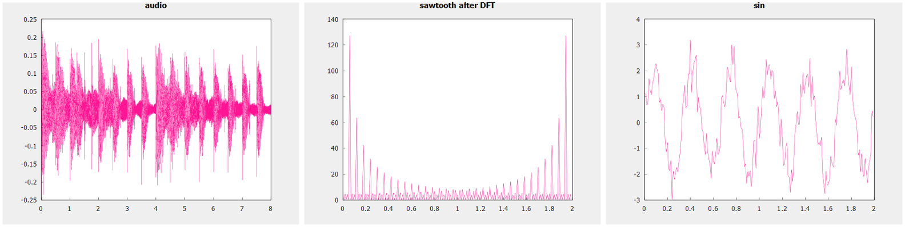

# Signal Processing C++

Biblioteka do generowania, analizy i wizualizacji sygnałów napisana w C++ i udostępniona w Pythonie
przez **pybind11**. Pozwala generować przebiegi okresowe, wczytywać i zapisywać pliki WAV, liczyć
dyskretną transformatę Fouriera (DFT/IDFT), dodawać szum i rysować wykresy (Matplot++).




## Funkcje

| Funkcja (Python) | Opis |
|---|---|
| `sin`, `cos`, `square`, `sawtooth(f, A, fs, t)` | generowanie sygnału o częstotliwości `f`, amplitudzie `A`, częstotliwości próbkowania `fs` i czasie trwania `t` |
| `audio_to_wave(path)` | wczytanie pliku WAV jako sygnału |
| `wave_to_audio(wave, path)` | zapis sygnału do pliku WAV |
| `DFT(wave)` | dyskretna transformata Fouriera (widmo amplitudowe + współczynniki zespolone) |
| `IDFT(wave)` | transformata odwrotna, odtwarza sygnał z widma |
| `noise(wave, level)` | dodanie szumu gaussowskiego o odchyleniu `level` |
| `plot(wave)` | wykres sygnału (Matplot++) |

DFT i IDFT są zaimplementowane bezpośrednio ze wzoru (złożoność O(N²)), bez zewnętrznych bibliotek FFT.

## Przykład

```python
import cmake_example as lib

wave = lib.sawtooth(3, 2, 100, 2)       # 3 Hz, amplituda 2, 100 próbek/s, 2 s
lib.plot(wave)

spectrum = lib.DFT(wave)
lib.plot(spectrum)
lib.plot(lib.IDFT(spectrum))           # z powrotem do dziedziny czasu

audio = lib.audio_to_wave("test-audio.wav")
lib.wave_to_audio(lib.noise(audio, 0.02), "noise.wav")
```

Pełny raport z wykresami i nagraniami: [`raport.ipynb`](raport.ipynb)
(pliki dźwiękowe odtwarza się najlepiej przez [nbviewer](https://nbviewer.org/github/praha6248/signal-processing-cpp/blob/master/raport.ipynb)).

## Budowanie

Wymagane: kompilator C++17, CMake, Python 3 z `pip`. Matplot++ do wyświetlania wykresów korzysta z gnuplota.

```bash
git clone --recursive https://github.com/praha6248/signal-processing-cpp.git
cd signal-processing-cpp
pip install .                 # buduje moduł cmake_example przez CMake
```

albo bezpośrednio przez CMake:

```bash
cmake -S . -B build
cmake --build build -j
PYTHONPATH=build python sygnal/sygnal.py
```

## Struktura

```
src/main.cpp        implementacja funkcji i moduł pybind11 (cmake_example)
sygnal/sygnal.py    przykładowy skrypt
raport.ipynb        raport z wynikami
setup.py            budowanie pakietu Pythona przez CMake
pybind11/, AudioFile/, matplotplusplus/   submoduły
test-audio.wav, noise.wav                 przykładowe nagrania
```

## Autorki i pochodzenie

Natalia Płocha, Zuzanna Czaja: projekt na przedmiot Techniki Programowania.
Konfiguracja budowania (`setup.py`, `CMakeLists.txt`) pochodzi z szablonu
[pybind/cmake_example](https://github.com/pybind/cmake_example), stąd jego licencja w pliku `LICENSE`.

## Technologie

C++ · pybind11 · Matplot++ · AudioFile · CMake · Python · Jupyter
